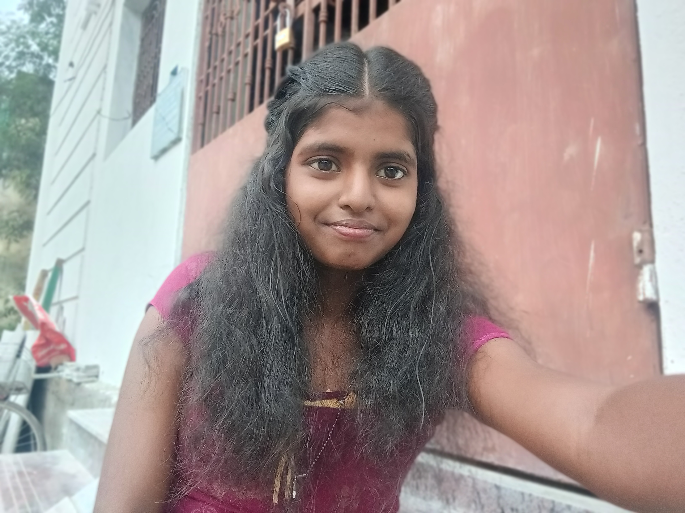

# Ex01 Portfolio
## Date:24-10-2026

## AIM
To create a Portfolio using HTML and CSS.

## ALGORITHM
### STEP 1
Create an HTML file (index.html)

### STEP 2
Create a CSS file (style.css)

### STEP 3
Include a navigation bar with links to different sections.

### STEP 4
Add structured sections for introduction, about, projects, and contact details.

### STEP 5
Define global styles for fonts, colors, and layout.

### STEP 6
Style the header, navigation bar, and sections.

### STEP 7
Use Flexbox or CSS Grid for layout design.

### STEP 8
Add hover effects and transitions for interactivity.

### STEP 9
Add Images and Media.

### STEP 10
Use optimized images for a professional look.

### STEP 11
Open the HTML file in a browser to check layout and functionality.

### STEP 12
Fix styling issues and refine content placement.

### STEP 13
Deploy the Portfolio.

### STEP 14
Upload to GitHub Pages for free hosting.

## PROGRAM
```
<!DOCTYPE html>
<html lang="en">
<head>
    <meta charset="UTF-8">
    <meta name="viewport" content="width=device-width, initial-scale=1.0">
    <title>Yuvashree | Portfolio</title>

    <style>
        * {
            margin: 0;
            padding: 0;
            box-sizing: border-box;
            scroll-behavior: smooth;
        }

        :root {
            --pink: #e75480;
            --light-pink: #fff0f5;
            --dark: #392331;
            --text: #705666;
            --white: #ffffff;
        }

        body {
            font-family: Arial, sans-serif;
            background: #fffafd;
            color: var(--dark);
            line-height: 1.7;
        }

        a {
            text-decoration: none;
            color: inherit;
        }

        .container {
            width: 88%;
            max-width: 1100px;
            margin: auto;
        }

        section {
            padding: 80px 0;
            scroll-margin-top: 80px;
        }

        .title {
            text-align: center;
            font-size: 35px;
            margin-bottom: 12px;
        }

        .title span {
            color: var(--pink);
        }

        .subtitle {
            text-align: center;
            color: var(--text);
            margin-bottom: 40px;
        }

        /* NAVIGATION */

        header {
            background: #fffafd;
            border-bottom: 1px solid #f6d7e4;
            position: sticky;
            top: 0;
            z-index: 10;
        }

        nav {
            min-height: 75px;
            display: flex;
            justify-content: space-between;
            align-items: center;
            gap: 20px;
        }

        .logo {
            font-size: 27px;
            font-weight: bold;
            color: var(--pink);
        }

        .nav-links {
            display: flex;
            gap: 23px;
            list-style: none;
        }

        .nav-links a {
            font-size: 14px;
            font-weight: bold;
            transition: 0.3s;
        }

        .nav-links a:hover {
            color: var(--pink);
        }

        /* HOME */

        #home {
            min-height: 88vh;
            display: flex;
            align-items: center;
            background: linear-gradient(135deg, #fffafd, #ffe3ee);
        }

        .hero {
            display: grid;
            grid-template-columns: 1.2fr 0.8fr;
            align-items: center;
            gap: 45px;
        }

        .hello {
            display: inline-block;
            padding: 7px 16px;
            border-radius: 25px;
            background: #ffe0eb;
            color: #b52f62;
            font-size: 13px;
            font-weight: bold;
            margin-bottom: 20px;
        }

        .hero h1 {
            font-size: clamp(38px, 5vw, 60px);
            line-height: 1.2;
            margin-bottom: 18px;
        }

        .hero h1 span {
            color: var(--pink);
        }

        .hero h3 {
            font-size: 20px;
            color: var(--text);
            font-weight: normal;
            margin-bottom: 15px;
        }

        .hero p {
            color: var(--text);
            margin-bottom: 25px;
        }

        .buttons {
            display: flex;
            flex-wrap: wrap;
            gap: 12px;
        }

        .btn {
            padding: 12px 22px;
            border-radius: 25px;
            font-size: 14px;
            font-weight: bold;
            transition: 0.3s;
        }

        .primary {
            background: var(--pink);
            color: white;
        }

        .primary:hover {
            background: #c93d6c;
            transform: translateY(-3px);
        }

        .outline {
            border: 2px solid var(--pink);
            color: var(--pink);
        }

        .outline:hover {
            background: var(--pink);
            color: white;
        }

        .hero-image {
            display: flex;
            justify-content: center;
            position: relative;
        }

        .photo-frame {
            width: 290px;
            height: 350px;
            padding: 9px;
            background: white;
            border: 3px solid #f2b6cf;
            border-radius: 48% 48% 35% 35%;
            box-shadow: 0 15px 40px #e7548020;
            transform: rotate(3deg);
        }

        .photo-frame img {
    width: 100%;
    height: 100%;
    object-fit: cover;
    object-position: center;
    border-radius: inherit;
}
        .photo-note {
            position: absolute;
            bottom: 20px;
            left: 0;
            background: white;
            color: var(--pink);
            padding: 10px 15px;
            border-radius: 15px;
            font-weight: bold;
            box-shadow: 0 5px 20px #00000010;
        }

        /* ABOUT */

        #about {
            background: white;
        }

        .about-card {
            max-width: 850px;
            margin: auto;
            padding: 32px;
            border-radius: 22px;
            background: var(--light-pink);
            border: 1px solid #f6d7e4;
        }

        .about-card p {
            color: var(--text);
            margin-bottom: 15px;
        }

        .education {
            display: flex;
            gap: 15px;
            padding: 20px;
            margin-top: 20px;
            background: white;
            border-radius: 15px;
        }

        .education-icon {
            font-size: 28px;
        }

        .education h3 {
            font-size: 17px;
        }

        .education p {
            font-size: 14px;
            margin: 4px 0 0;
        }

        /* SKILLS */

        .skills-grid {
            display: grid;
            grid-template-columns: repeat(3, 1fr);
            gap: 22px;
        }

        .skill-card {
            padding: 28px 18px;
            text-align: center;
            background: white;
            border: 1px solid #f4d5e2;
            border-radius: 20px;
            transition: 0.3s;
        }

        .skill-card:hover {
            transform: translateY(-7px);
            box-shadow: 0 12px 30px #e7548015;
            border-color: var(--pink);
        }

        .skill-icon {
            font-size: 35px;
            margin-bottom: 10px;
        }

        .skill-card h3 {
            margin-bottom: 8px;
        }

        .skill-card p {
            color: var(--text);
            font-size: 14px;
        }

        /* PROJECTS */

        #projects {
            background: white;
        }

        .projects-grid {
            display: grid;
            grid-template-columns: repeat(2, 1fr);
            gap: 25px;
        }

        .project-card {
            overflow: hidden;
            border: 1px solid #f3d6e2;
            border-radius: 22px;
            background: #fffafd;
            transition: 0.3s;
        }

        .project-card:hover {
            transform: translateY(-6px);
            box-shadow: 0 12px 30px #e7548015;
        }

        .project-banner {
            height: 155px;
            display: flex;
            justify-content: center;
            align-items: center;
            font-size: 55px;
            background: linear-gradient(135deg, #ffe7f0, #f6c5da);
        }

        .project-content {
            padding: 24px;
        }

        .project-content h3 {
            font-size: 21px;
            margin-bottom: 10px;
        }

        .project-content p {
            color: var(--text);
            font-size: 14px;
            margin-bottom: 16px;
        }

        .tags {
            display: flex;
            flex-wrap: wrap;
            gap: 8px;
            margin-bottom: 18px;
        }

        .tags span {
            background: #ffe4ee;
            color: #a93261;
            border-radius: 20px;
            padding: 5px 11px;
            font-size: 12px;
        }

        .project-link {
            color: var(--pink);
            font-weight: bold;
        }

        /* CONTACT */

        #contact {
            background: linear-gradient(135deg, #fffafd, #ffe5ef);
        }

        .contact-card {
            max-width: 720px;
            margin: auto;
            padding: 35px;
            text-align: center;
            background: white;
            border: 1px solid #f4d6e3;
            border-radius: 22px;
        }

        .contact-card p {
            color: var(--text);
            margin: 15px 0 25px;
        }

        .contact-links {
            display: flex;
            flex-wrap: wrap;
            justify-content: center;
            gap: 12px;
        }

        .contact-link {
            padding: 10px 17px;
            border: 1px solid #efbfd2;
            border-radius: 25px;
            color: #a93261;
            font-size: 14px;
            font-weight: bold;
            transition: 0.3s;
        }

        .contact-link:hover {
            background: var(--pink);
            color: white;
        }

        /* FOOTER */

        footer {
            padding: 22px;
            text-align: center;
            background: #392331;
            color: #f9dce8;
            font-size: 13px;
        }

        footer span {
            color: #ff91b8;
        }

        /* MOBILE RESPONSIVE */

        @media (max-width: 800px) {
            .hero {
                grid-template-columns: 1fr;
                text-align: center;
                gap: 40px;
            }

            #home {
                padding-top: 60px;
            }

            .hero-image {
                grid-row: 1;
            }

            .hero p {
                max-width: 550px;
                margin-left: auto;
                margin-right: auto;
                margin-bottom: 25px;
            }

            .buttons {
                justify-content: center;
            }

            .photo-frame {
                width: 240px;
                height: 290px;
            }

            .photo-note {
                left: 5%;
            }

            .skills-grid {
                grid-template-columns: repeat(2, 1fr);
            }

            .nav-links {
                gap: 12px;
            }

            .nav-links a {
                font-size: 12px;
            }
        }

        @media (max-width: 520px) {
            nav {
                flex-direction: column;
                justify-content: center;
                padding: 12px 0;
                gap: 8px;
            }

            .nav-links {
                justify-content: center;
                flex-wrap: wrap;
                gap: 8px 14px;
            }

            .hero h1 {
                font-size: 38px;
            }

            .hero h3 {
                font-size: 17px;
            }

            section {
                padding: 60px 0;
            }

            .title {
                font-size: 29px;
            }

            .skills-grid,
            .projects-grid {
                grid-template-columns: 1fr;
            }

            .about-card,
            .contact-card {
                padding: 22px;
            }
        }
    </style>
</head>

<body>

    <!-- NAVBAR -->
    <header>
        <nav class="container">
            <a href="#home" class="logo">Yuvas😚</a>

            <ul class="nav-links">
                <li><a href="#home">Home</a></li>
                <li><a href="#about">About</a></li>
                <li><a href="#skills">Skills</a></li>
                <li><a href="#projects">Projects</a></li>
                <li><a href="#contact">Contact</a></li>
            </ul>
        </nav>
    </header>

    <!-- HOME -->
    <section id="home">
        <div class="container hero">

            <div>
                <div class="hello">🌸 Welcome to my portfolio</div>

                <h1>Hi, I'm <span>Yuvashree!</span></h1>

                <h3>Computer Science Engineering Student</h3>

                <p>
                    I'm a third-year B.E. Computer Science student
                    passionate about learning new technologies and
                    creating useful websites. I'm improving my coding
                    skills by building practical projects.
                </p>

                <div class="buttons">
                    <a href="#projects" class="btn primary">
                        View My Projects
                    </a>

                    <a href="#contact" class="btn outline">
                        Contact Me
                    </a>
                </div>
            </div>

            <div class="hero-image">
                <div class="photo-frame">
                    <!-- Replace the URL below with your own photo -->
                    
                </div>

                <div class="photo-note">✨ Learning & Growing</div>
            </div>

        </div>
    </section>

    <!-- ABOUT -->
    <section id="about">
        <div class="container">
            <h2 class="title">About <span>Me</span></h2>

            <p class="subtitle">A little introduction about me 🌷</p>

            <div class="about-card">
                <p>
                    Hello! I'm Yuvashree R, a third-year B.E. Computer
                    Science and Engineering student at Saveetha
                    Engineering College, Chennai.
                </p>

                <p>
                    I have basic knowledge of HTML, CSS, Java, Python
                    and DBMS. I enjoy web development and learning
                    how software applications are created.
                </p>

                <p>
                    My goal is to improve my technical knowledge,
                    build useful projects and start my career in
                    a good company.
                </p>

                <div class="education">
                    <div class="education-icon">🎓</div>

                    <div>
                        <h3>B.E. Computer Science and Engineering</h3>
                        <p>Saveetha Engineering College, Chennai</p>
                        <p>Third Year | Graduation year: 2028</p>
                    </div>
                </div>
            </div>
        </div>
    </section>

    <!-- SKILLS -->
    <section id="skills">
        <div class="container">
            <h2 class="title">My <span>Skills</span></h2>

            <p class="subtitle">
                Technologies I'm learning and practising 💻
            </p>

            <div class="skills-grid">

                <div class="skill-card">
                    <div class="skill-icon">🌐</div>
                    <h3>HTML</h3>
                    <p>Creating webpage structures and content.</p>
                </div>

                <div class="skill-card">
                    <div class="skill-icon">🎨</div>
                    <h3>CSS</h3>
                    <p>Designing layouts and responsive pages.</p>
                </div>

                <div class="skill-card">
                    <div class="skill-icon">☕</div>
                    <h3>Java</h3>
                    <p>Learning programming concepts and logic.</p>
                </div>

                <div class="skill-card">
                    <div class="skill-icon">🐍</div>
                    <h3>Python</h3>
                    <p>Practising coding and problem-solving.</p>
                </div>

                <div class="skill-card">
                    <div class="skill-icon">🗄️</div>
                    <h3>DBMS</h3>
                    <p>Understanding databases and SQL basics.</p>
                </div>

                <div class="skill-card">
                    <div class="skill-icon">🧩</div>
                    <h3>Problem Solving</h3>
                    <p>Developing logical thinking through practice.</p>
                </div>

            </div>
        </div>
    </section>

    <!-- PROJECTS -->
    <section id="projects">
        <div class="container">
            <h2 class="title">My <span>Projects</span></h2>

            <p class="subtitle">
                Projects I'm working on and exploring 🌸
            </p>

            <div class="projects-grid">

                <div class="project-card">
                    <div class="project-banner">🌱</div>

                    <div class="project-content">
                        <h3>Crop Disease Detection</h3>

                        <p>
                            A software project focused on identifying
                            crop diseases from plant images and
                            predicting crop yield to help farmers
                            make better decisions.
                        </p>

                        <div class="tags">
                            <span>HTML</span>
                            <span>CSS</span>
                            <span>Python</span>
                            <span>Machine Learning</span>
                        </div>

                        <a href="#contact" class="project-link">
                            Project Details →
                        </a>
                    </div>
                </div>

                <div class="project-card">
                    <div class="project-banner">📋</div>

                    <div class="project-content">
                        <h3>Trackly – Daily Tracker</h3>

                        <p>
                            A productivity website concept to organise
                            daily tasks, track activities and manage
                            personal notes in one place.
                        </p>

                        <div class="tags">
                            <span>HTML</span>
                            <span>CSS</span>
                            <span>Web Design</span>
                        </div>

                        <a href="#contact" class="project-link">
                            Project Details →
                        </a>
                    </div>
                </div>

            </div>
        </div>
    </section>

    <!-- CONTACT -->
    <section id="contact">
        <div class="container">
            <h2 class="title">Let's <span>Connect</span></h2>

            <p class="subtitle">
                Have an opportunity? Let's connect! 💌
            </p>

            <div class="contact-card">
                <h3>Thank you for visiting my portfolio!</h3>

                <p>
                    I'm interested in learning new technologies,
                    working on projects and exploring career
                    opportunities. Feel free to connect with me.
                </p>

                <div class="contact-links">

                    <!-- Replace with your actual email -->
                    <a class="contact-link"
   href="https://mail.google.com/mail/?view=cm&fs=1&to=yuvasr22112006@gmail.com"
   target="_blank"
   rel="noopener noreferrer">
    ✉ Mail
</a>
                    <!-- Replace with your LinkedIn profile -->
                    <a class="contact-link"
                       href="https://www.linkedin.com/in/yuvas-hree-07a97332a"
                       target="_blank"
                       rel="noopener noreferrer">
                        💼 LinkedIn
                    </a>

                    <!-- Replace with your GitHub profile -->
                    <a class="contact-link"
                       href="https://github.com/Yuvashree2211"
                       target="_blank"
                       rel="noopener noreferrer">
                        💻 GitHub
                    </a>

                </div>
            </div>
        </div>
    </section>

    <!-- FOOTER -->
    <footer>
        <p>Made with <span>♥</span> by Yuvashree | © 2026</p>
    </footer>

</body>
</html>

```

## OUTPUT


## RESULT
The program for creating Portfolio using HTML and CSS is executed successfully.
